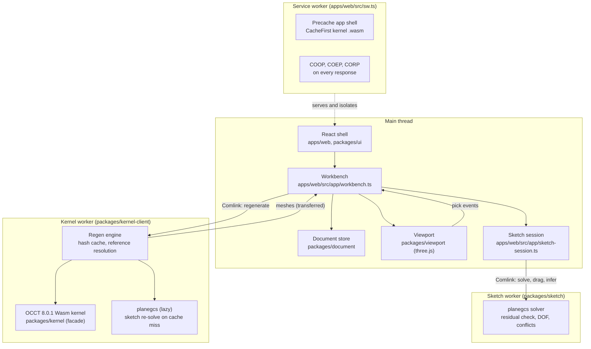

# Architecture

This page describes the code as it is in the M1 build (deployed) and notes what is still planned.
The target design, with the full rationale, is in [`PLAN.md`](PLAN.md) §4. Decisions are logged in
[`DECISIONS.md`](DECISIONS.md) (ADR numbers are linked below).

## 1. The big picture

Whittle is a browser app with three workers. The main thread only holds document state, UI and the
viewport. Everything heavy runs off it: the OCCT kernel and the regeneration engine in the kernel
worker, the constraint solver in the sketch worker. A service worker serves the app and adds the
headers that make threads possible.

Rules that hold in the code:

- The main thread never calls Wasm. The OCCT kernel is instantiated only inside the kernel worker
  (`packages/kernel-client/src/worker.ts` and `kernel-api.ts`). `packages/kernel/src/index.ts`
  holds types and pure helpers only.
- The kernel worker owns every OCCT shape. The main thread only holds integer handles and
  transferred render buffers.
- Meshes are transferred with Comlink's `transfer()`, not copied (see
  `packages/kernel-client/src/regen/buffers.ts`).

The drawing worker shown in PLAN §4 (HLR, lazy-loaded) is not built yet (M4).

## 2. Data flow: from an edit to the screen

1. **Edit.** A tool, an inspector field or a drag becomes a `Command` (`packages/contracts/src/store.ts`).
   `DocumentStore.apply` turns it into RFC 6902 JSON-patch operations and applies them immutably.
   Edits that share a `coalesceKey` merge into one history entry while the group is open. The
   default idle window is 1 s and history keeps up to 500 entries (`packages/document/src/store.ts`).
2. **Regen request.** The workbench sends the whole document to the engine with `regenerate({ doc,
   partId, quality, massProperties })`. Each request carries a monotonic `revision`, so stale
   results can be dropped. An edit first gets a `coarse` regeneration. When the edits settle, a
   `fine` one follows while the app is idle (`apps/web/src/model/modeling.ts`).
3. **Incremental regeneration.** The engine walks the features up to the rollback index. For each
   feature it evaluates expressions, resolves references against the current state, and computes a
   content hash. A hit reuses the cached result. A miss calls the kernel (`execFeature`) and then
   meshes the result (`mesh`) (`packages/kernel-client/src/regen/engine.ts`).
4. **Result.** The engine returns per-feature status (`ok`, `error`, `needsAttention`, `suppressed`,
   `rolledBack`, `blocked`), warnings, rebound references, and ghosts (last good geometry). Body
   meshes come back transferred.
5. **Healing.** Rebound references are written back in the same undo step as the user's next edit
   (ADR-008 §1, `apps/web/src/model/heal.ts`).
6. **Viewport.** The workbench calls `setBodies`, ghosts and markers on the viewport. Picks flow
   back as `PickHit`s through the workbench (`apps/web/src/app/workbench.ts`).

## 3. Packages

| Package | Responsibility | Key entry points | Contract |
| --- | --- | --- | --- |
| `apps/web` | Composition root: boot, workbench, shells wiring, library, samples, service worker | `src/main.tsx`, `src/app/workbench.ts`, `src/sw.ts` | Uses all contracts |
| `packages/contracts` | Shared types and API surfaces (lead-owned) | `src/index.ts` | This package is the contract |
| `packages/document` | Expression engine with units, store with undo, `.whittle` codec, materials, JSON Schema | `createDocumentStore`, `expressionEngine`, `projectCodec`, `MATERIALS` | `document.ts`, `store.ts`, `expressions.ts`, `io.ts` |
| `packages/kernel` | OCCT 8.0.1 Wasm kernel: C++ facade and the libcascade build | `src/whittle_kernel.h`, `src/index.ts` (types only) | `kernel.ts`, `whittle_kernel.h` |
| `packages/kernel-client` | Kernel worker, Comlink client, regeneration engine | `createKernelClient`, `@whittle/kernel-client/regen` | `kernel.ts` (`KernelApi`), `modeling.ts` (`ModelingApi`) |
| `packages/sketch` | planegcs sketch solver, DOF, conflicts, inference, drawing tools | `createSketchSolverClient`, `@whittle/sketch/worker` | `sketch.ts` |
| `packages/viewport` | three.js viewport: camera, picking, overlays, ghosts | `createViewport` | `viewport.ts` (`Viewport`, `CreateViewport`) |
| `packages/ui` | Design tokens, Radix-based primitives, three shells, feature tree, inspectors | `AppShell`, `FeatureTree`, `SketchToolbar` | Props types only |
| `packages/io` | STL, OBJ, 3MF, GLB; STL analysis; local library (IndexedDB and OPFS); file pickers | `meshExporters`, `importMesh` (`.`), `openLibrary` (`./browser`) | `io.ts` |
| `packages/test-fixtures` | Synthetic `MeshBuffers` and sketch fixtures for tests | `boxMesh`, `sketchFixture` | Uses `kernel.ts`, `sketch.ts` |

The dependency direction is one-way: `apps/web` depends on everything, the packages depend on
`contracts` and not on each other except for documented exceptions (`kernel-client` uses `sketch`
and `io`).

## 4. Persistent naming and reference resolution

Whittle never silently guesses which topology a reference points to. The model is in PLAN §7.3 and
the rules are implemented in `packages/kernel-client/src/regen/resolve.ts`.

- **Names come from history.** The kernel names results from OCCT's `Generated`, `Modified` and
  `IsDeleted` records. Examples are `F<id>:start`, `F<id>:side(...)`, `F<id>:fillet(...)`, and sketch
  names `S<id>:e(...)` (`packages/contracts/src/naming.ts` documents the grammar). Splits get a
  deterministic `#k` suffix.
- **Stored references carry fingerprints.** An `EntityRef` stores its name and a fingerprint (a
  centroid, a normal, and an area or length). See `packages/contracts/src/document.ts`.
- **Resolution order.** An exact name is accepted when it is still plausibly the same entity. Name
  families are then disambiguated by fingerprint. Next, a fingerprint-only match within tolerance is
  tried. Anything else is unresolved.
- **Unresolved means "needs attention".** The feature is flagged, its old location is ghosted, and
  the user re-picks. If several candidates match, the "Which one?" chooser lists them.
- **Imported faces are weak names.** Faces of imported files have no construction history, so their
  names rely more on fingerprints (`naming.ts`).
- **Picking shows the input.** While a feature's pick field is active, the viewport shows the model
  as it was before that feature (ADR-007 §1), so picks always name input geometry.

The kernel-client tests cover this with golden suites. These include edits that split and merge
faces, and suppression and rollback (`packages/kernel-client/test/regen/`).

## 5. The sketch solver

`packages/sketch` wraps planegcs (`@salusoft89/planegcs`, LGPL-2.0-or-later). It owns the policy.

- **planegcs solves; Whittle verifies.** planegcs solves the driving constraints. Whittle keeps its
  own residual model (`src/model.ts`) and re-checks every residual. A sketch is only reported as
  `solved` when every residual is within tolerance (1e-7 times the sketch scale for lengths, 1e-7
  for angles). Reference dimensions never reach planegcs; they are measured afterwards.
- **DOF.** Degrees of freedom come from a Jacobian rank analysis (`src/analysis.ts`). Each entity is
  reported as `fixed`, `partial` or `free`. The UI shows these as colours (see §7).
- **Conflicts.** Per connected component, QuickXplain (Junker, 2004) finds a minimal conflicting set
  of constraints. The lowest-priority member is relaxed and the search repeats. Each conflict has a
  plain-language explanation and suggested fixes (`src/solver.ts`, `src/explain.ts`).
- **Dragging.** A drag adds temporary planegcs constraints that pull the grabbed geometry toward the
  cursor, in a separate system that is re-solved on every move.
- **Where it runs.** The sketch worker serves interactive solves. The kernel worker also loads
  planegcs, lazily, to re-solve a sketch when the regen cache misses.
- **Not built:** the "polish" step proposed for M2 (ADR-008 §9). Two coincident faces from separate
  sketches can still leave a sliver because of the solver tolerance.

The drag budget is asserted in `packages/sketch/test/drag.test.ts` (median ≤ 4 ms for 200 entities,
relaxed on CI).

## 6. The viewport

`packages/viewport` is imperative three.js, with a deliberately small surface.

- **Renderer.** `WebGPURenderer`, which falls back to WebGL2 automatically. The backend in use is
  reported in the runtime diagnostics. Rendering is on demand: the loop runs while the camera moves
  or a pointer is down, and otherwise sleeps.
- **Camera.** `camera-controls`. Mouse: left drag orbits, right or middle drag pans, the wheel
  zooms toward the cursor. Touch: one finger orbits, two fingers pinch and pan, three fingers pan.
  Double-click or double-tap fits the view.
- **Edges.** Fat lines (`LineSegments2`), so edges have a constant screen width.
- **Picking.** Faces are picked from a GPU ID buffer. It is rendered and read back asynchronously
  when it matches the current camera. When it is stale, the viewport falls back to a
  `three-mesh-bvh` raycast. Edges and vertices are picked by screen-space distance
  (`src/pick.ts`).
- **Overlays.** Sketch geometry is coloured by DOF state. Ghosts and "needs attention" markers are
  drawn as translucent proxies (`setGhost`). A view cube in the top-right corner sets the standard
  views. It is on by default (`viewCube`).

## 7. Storage

- **Library.** Metadata is in IndexedDB (`idb`). Blobs (thumbnails, extra files, mesh caches) are in
  OPFS when it is usable, with an IndexedDB blob fallback (`packages/io/src/library.ts`).
- **Autosave.** The open document is saved 500 ms after edits settle, and again when the page is
  hidden (`apps/web/src/doc/autosave.ts`, ADR-007 §5). The last document reopens on launch.
- **Project folder and `.whittle`.** A project is a folder of canonical JSON (sorted keys, LF,
  fixed indentation), so equal documents give identical bytes. A `.whittle` file is that folder as a
  deterministic ZIP (`fflate`). The format is specified in [`FILE_FORMAT.md`](FILE_FORMAT.md).
- **Imports.** The bytes of an imported file are stored as an attachment at
  `imports/<featureId>.<ext>` and identified by SHA-256 (ADR-008 §3).
- **Mesh cache.** Fine meshes are written to `.whittle/meshes/`, keyed by a hash of the document.
  A stale cache is ignored. On launch the cached meshes render before the kernel is ready (ADR-008
  §4).
- **Kernel binaries.** The `.wasm` and glue are cached by the service worker in
  `whittle-kernel-v1` on first use (ADR-005 §2).
- **Export.** Where the browser supports it, saves use the File System Access API. Otherwise they
  download (`packages/io/src/files.ts`).

## 8. PWA, cross-origin isolation and updates

- **Service worker.** One worker, built with `vite-plugin-pwa` in `injectManifest` mode from
  `apps/web/src/sw.ts`. It precaches the app shell (not the kernel). Kernel `.wasm` and glue are
  cached on first use. Other same-origin requests go to the network.
- **Isolation headers.** Every response from our origin gets `Cross-Origin-Opener-Policy:
  same-origin`, `Cross-Origin-Embedder-Policy: require-corp` and `Cross-Origin-Resource-Policy:
  same-origin` (`apps/web/src/platform/isolation-headers.ts`). `require-corp` is used rather than
  `credentialless` because Safari does not support the latter (ADR-005 §1). The Vite dev and preview
  servers and `apps/web/public/_headers` send the same headers.
- **First visit.** The service worker installs and claims the page. The page reloads once to become
  isolated. A session flag prevents loops. If the page is still not isolated, the kernel boots in
  single-threaded mode (`apps/web/src/platform/sw-register.ts`, ADR-005 §5).
- **Updates.** A new service worker waits. If you have not interacted with the page yet, it is applied
  at once. Otherwise the app shows "Update available · Reload". Updates are checked on focus, on
  visibility change and every 30 minutes, and on demand from the command palette.

## 9. Device tiers

`detectTier` (`apps/web/src/platform/diagnostics.ts`) assigns a tier at startup:

- **Phone**: a coarse pointer and a shortest screen side under 600 CSS px.
- **Tablet**: a coarse pointer on a larger screen, or a fine-pointer machine with fewer than 4 cores
  or less than 4 GiB of memory (`navigator.deviceMemory`, where available).
- **Desktop**: everything else.

The tier chooses the shell (`AppShell` renders `DesktopShell`, `TabletShell` or `PhoneShell`), the
touch density, and the per-part regen cache size. `spareResultsFor` gives phones 2 spare results and
tablets 4. Desktop uses the engine default of 128 (`apps/web/src/model/modeling.ts`).

Not built: PLAN §8.4 asks that phones load the kernel lazily, only when an edit starts. The app
currently boots the kernel on every tier at startup (`Workbench.bootKernel`).

## 10. Performance budgets and how CI checks them

| Budget (PLAN §10) | Where it is checked |
| --- | --- |
| Initial-route JavaScript ≤ 250 kB gzip | `size-limit` in the CI `build` job (`apps/web/.size-limit.mjs`) |
| Shell visible in ≤ 1.5 s (warm) | Asserted in `apps/web/e2e/perf/shell.perf.ts` (`pnpm perf`) |
| Regeneration after the last feature of a 50-feature part ≤ 300 ms | Asserted (median) in `packages/kernel-client/test/regen/cache.test.ts` |
| Sketch drag solve ≤ 4 ms for 200 entities | Asserted (median) in `packages/sketch/test/drag.test.ts`; limit relaxed to 12 ms on CI |
| Kernel `.wasm` ≤ 15 MB brotli | Asserted by `packages/kernel/scripts/size-report.mjs` during the kernel build |
| Cached open before the kernel is ready (≤ 500 ms) | Measured (marks in `apps/web/src/app/timing.ts`) and noted in ADR-007 §4 and ADR-008 §4. Not asserted |
| Kernel ready (cold and warm) | Measured, not asserted |
| Viewport frame time at 1M triangles | Opt-in probes (`WHITTLE_PERF=1`); they log numbers and do not assert |
| Push and pull preview in one frame | Not built (push and pull, §12) |
| Memory on iPad tier | Not measured |

Timing assertions depend on the machine. CI runs on 2-vCPU runners with software GL, so the
thresholds are loose there, and the perf project runs serially.

## 11. Testing pyramid

- **Unit (Vitest).** `pnpm test` runs every package's `test` script. This includes expressions,
  the store, the codec, the schema generator and its staleness check, the sketch solver, the regen
  engine's pure parts, the io codecs, UI components with Testing Library and jsdom, and the app's
  own modules.
- **Kernel golden tests (Node, real kernel).** `packages/kernel/test` checks volumes, areas and face
  counts for primitives, modeling operations and I/O round trips. `packages/kernel-client/test/regen`
  checks regeneration, naming, topology, imports and cache behaviour. Both are skipped with a note
  when `packages/kernel/dist` is missing.
- **E2E (Playwright).** `apps/web/e2e` runs the whole app on the production build, served the way
  GitHub Pages serves it, so isolation can only come from the service worker. Chromium gates the
  deploy. Firefox and WebKit run but do not yet gate (ADR-005 §7). `packages/viewport/e2e` and
  `packages/ui/e2e` test the viewport and the UI in CI's package-E2E job.
- **Visual.** The UI suite has screenshot tests. CI runs them with `--ignore-snapshots` until
  CI-generated baselines are committed (ADR-005 §6).
- **Perf.** `pnpm perf` (see §10).
- **Schema.** `apps/web/e2e/schema.ts` validates documents against the published JSON Schemas.

The CI pipeline is in [`.github/workflows/ci.yml`](../.github/workflows/ci.yml). Lint runs first,
then the kernel build (cached), typecheck and unit tests, the build and size budget, and the E2E
suites. The Pages deploy runs only on `main`, after all of them pass.

## 12. Not built yet

These are in the plan but not wired in this build. The contract types may exist.

- **Push and pull.** The `pushPull` feature type exists in the contract. The regen engine has a
  planner for it, but the kernel façade has no `pushPull` handler and the UI has no tool. A feature
  of this type fails with `UNSUPPORTED_FEATURE`.
- **IGES import.** The import formats include IGES, but the engine rejects it with "export it as
  STEP".
- **BREP export from the UI.** The kernel and the `ExportFormat` type support BREP. The export menu
  does not offer it.
- **Sphere creation.** The kernel builds spheres and the inspector can edit one, but no tool creates
  one.
- **Shell, pattern, hole and measure tools.** Listed in the command bar as disabled.
- **Draft on extrude.** The field exists, but a non-zero draft is rejected by the kernel.
- **Phone measure and section.** The phone's Measure and Section tabs are placeholders.
- **Pencil and tablet gestures.** Planned for M2.
- **Sync, version history, drawings, assemblies.** Planned for M2.5 to M6.

## 13. Decisions

- [ADR-001](DECISIONS.md#adr-001--technology-stack-2026-11-08): the technology stack.
- [ADR-002](DECISIONS.md#adr-002--kernel-toolchain-libcascade--libcascadetoolchain-2026-11-08): the kernel toolchain (`libcascade`).
- [ADR-003](DECISIONS.md#adr-003--license-gpl-30-or-later-2026-11-08): GPL-3.0-or-later.
- [ADR-004](DECISIONS.md#adr-004--materials-and-density-are-part-of-the-document-2026-11-08): materials are part of the document.
- [ADR-005](DECISIONS.md#adr-005--m0-integration-decisions-2026-11-08): isolation headers, runtime kernel caching, lazy viewport, and the first-frame and CI choices.
- [ADR-006](DECISIONS.md#adr-006--expression-semantics-for-bare-numbers-and-units-2026-11-08): expression semantics.
- [ADR-007](DECISIONS.md#adr-007--m1-app-integration-decisions-2026-11-08): picking rolls back to the input, the real engine by default, the welcome card, autosave.
- [ADR-008](DECISIONS.md#adr-008--m1-gate-fixes-in-the-app-2026-11-08): healing, the import and library rules, the mesh cache, and sketch tolerance.
